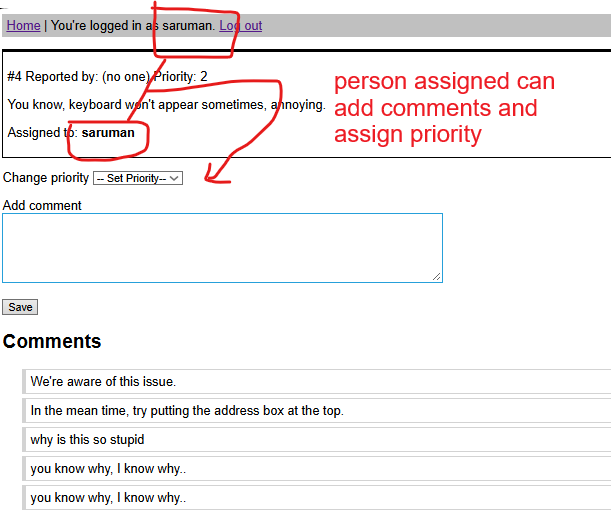

# Bug Tracking program written with ASP.Net Core (Razor)

Demo bug tracker to show C# and ASP.Net skills. Some features are missing; for example
> User authentication not properly done.
> No log in persistence
> Single tenant (can easily be modified for multi tenant use)

Back end database is SQLite.

Main page

Login page

After logging in (user name at the top)

Details of the report

Drop down list with registered users

Adding a new comment

Comment added

Report new bug

Person assigned to a report (person in charge) can change priority and add comments

.. other users cannot.

Admin can assign person in charge and add comments and change priority.

