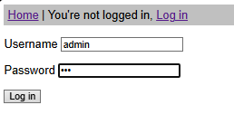
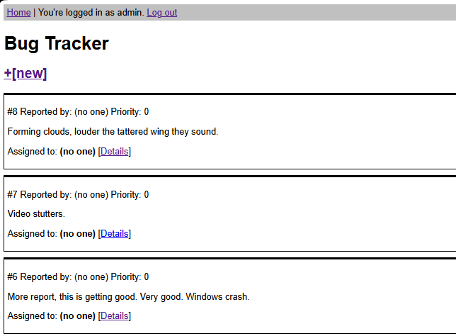
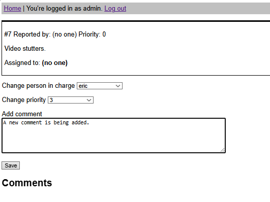
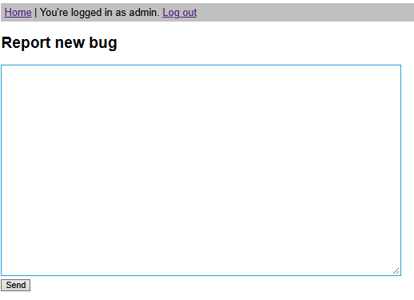
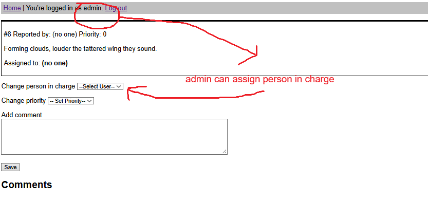

# Bug Tracking program written with ASP.Net Core (Razor)

Demo bug tracker to show C# and ASP.Net skills. Some features are missing; for example

- User authentication not properly done. Just a simple check.
- No log in persistence
- Single tenant (can easily be modified for multi tenant use)

Back end database is SQLite.
 
 
Main page 

  
Login page 

  
After logging in (user name at the top) 

  
Details of the report 

  
Drop down list with registered users 

  
Adding a new comment 

  
Comment added 

  
Report new bug 

  
Person assigned to a report (person in charge) can change priority and add comments

  
.. other users cannot. 

  
Admin can assign person in charge and add comments and change priority. 

